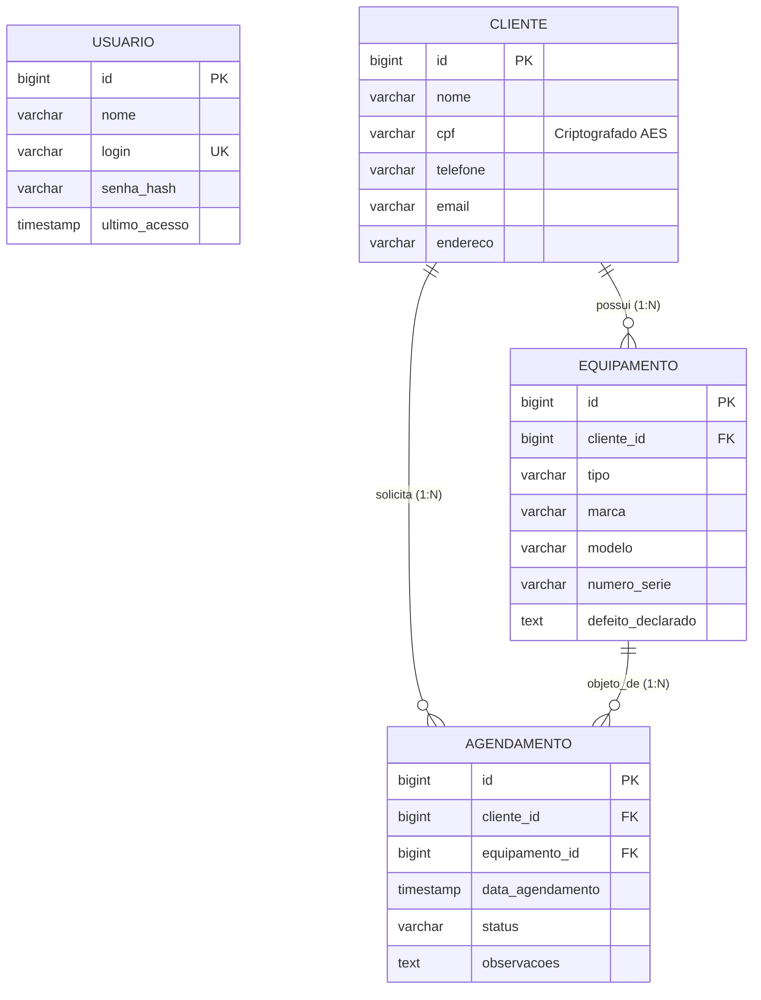

# Sistema de Gestão de Assistência Técnica de Equipamentos Eletrônicos

Este projeto é uma solução completa desenvolvida em **Java (Spring Boot 3)** com frontend integrado em **Thymeleaf e Bootstrap 5**, projetada para suprir as necessidades de controle operacional de agendamentos, clientes e equipamentos eletrônicos, além de garantir plena conformidade com as diretrizes da **Lei Geral de Proteção de Dados (LGPD)**.

---

## 📋 Sumário
- [1. Contexto e Diagnóstico](#1-contexto-e-diagnóstico)
- [2. Mapeamento das Regras de Negócio (RN01 a RN07)](#2-mapeamento-das-regras-de-negócio)
- [3. Diagrama Entidade-Relacionamento (DER)](#3-diagrama-entidade-relacionamento-der)
- [4. Stack Tecnológica](#4-stack-tecnológica)
- [5. Estrutura do Projeto](#5-estrutura-do-projeto)
- [6. Como Executar o Projeto](#6-como-executar-o-projeto)
- [7. Credenciais de Acesso](#7-credenciais-de-acesso)

---

## 1. Contexto e Diagnóstico

Uma assistência técnica enfrentava perda de atendimentos, dados cadastrais duplicados e ausência de mecanismos seguros de guarda de dados de clientes (notadamente o CPF). 

A solução informatiza todo o ciclo de vida do atendimento:
1. **Controle de Acesso com Sessão Expirável:** Evita acessos indevidos em terminais ociosos.
2. **Criptografia em Repouso do CPF:** Protege dados sensíveis no banco de dados contra vazamentos e atende à LGPD.
3. **Integridade Relacional Estrita:** Equipamentos e atendimentos são obrigatoriamente vinculados a clientes válidos.
4. **Interface Intuitiva e Responsiva:** Telas limpas para agilidade do operador na bancada e balcão.

---

## 2. Mapeamento das Regras de Negócio

| Regra | Descrição | Implementação Técnica |
| :--- | :--- | :--- |
| **RN01** | Script do banco com $\ge$ 3 registros para todas as tabelas com tipos, PKs e FKs válidas. | Arquivo `schema.sql` (DDL com constraints) e `data.sql` (DML com 3 usuários, 3 clientes, 3 equipamentos e 3 agendamentos). |
| **RN02** | Validação no login em caso de falha com mensagem adequada ao usuário. | Spring Security com redirecionamento para `/login?error=true` exibindo alerta contextualizado no template `login.html`. |
| **RN03** | CPF dos clientes armazenado de forma criptografada no banco de dados. | `CpfCryptoConverter` implementando `AttributeConverter<String, String>` com cifra simétrica **AES-128/256**, convertendo o dado de forma transparente nas operações JPA. |
| **RN04** | Tela principal (Dashboard) exibindo o nome do usuário logado, navegação aos recursos e botão de logout. | `DashboardController`, menu fragmentado (`navbar.html`) com `sec:authentication="name"`, métricas e formulário POST para `/logout`. |
| **RN05** | Funcionalidade de clientes com busca por termo confirmado e edição com persistência no banco. | Consulta customizada `@Query` no `ClienteRepository`, barra de busca com botão explícito de confirmação e modal para edição (`/clientes/editar`). |
| **RN06** | Listagem de agendamentos ordenada por data, detalhando cliente e equipamento, com recurso de reagendamento. | Query `findAllOrderByDataAgendamentoAsc()` com `JOIN FETCH`, exibição detalhada e modal com formulário para atualizar a data (`/agendamentos/reagendar`). |
| **RN07** | Cadastro de equipamento obrigatoriamente associado a um cliente pré-existente. | Constraint `FOREIGN KEY (cliente_id) REFERENCES cliente(id)` e campo obrigatório `<select required>` no formulário de equipamentos (`Equipamento.cliente` com `optional = false`). |

---

## 3. Diagrama Entidade-Relacionamento (DER)



---

## 4. Stack Tecnológica

* **Backend:** Java 17+ / Spring Boot 3.3.5
* **Segurança:** Spring Security 6 (BCrypt, expiração de sessão após 15 min, CSRF)
* **Persistência:** Spring Data JPA / Hibernate
* **Banco de Dados:** H2 Database (em memória/arquivo configurável) e suporte a PostgreSQL
* **Frontend:** Thymeleaf + Bootstrap 5 + Bootstrap Icons

---

## 5. Estrutura do Projeto

```text
CRUD/
├── pom.xml
├── README.md
├── src/
│   ├── main/
│   │   ├── java/com/assistencia/
│   │   │   ├── AssistenciaTecnicaApplication.java
│   │   │   ├── config/
│   │   │   │   └── SecurityConfig.java
│   │   │   ├── controller/
│   │   │   │   ├── AuthController.java
│   │   │   │   ├── DashboardController.java
│   │   │   │   ├── ClienteController.java
│   │   │   │   ├── EquipamentoController.java
│   │   │   │   └── AgendamentoController.java
│   │   │   ├── converter/
│   │   │   │   └── CpfCryptoConverter.java
│   │   │   ├── model/
│   │   │   │   ├── Usuario.java
│   │   │   │   ├── Cliente.java
│   │   │   │   ├── Equipamento.java
│   │   │   │   └── Agendamento.java
│   │   │   ├── repository/
│   │   │   │   ├── UsuarioRepository.java
│   │   │   │   ├── ClienteRepository.java
│   │   │   │   ├── EquipamentoRepository.java
│   │   │   │   └── AgendamentoRepository.java
│   │   │   └── service/
│   │   │       └── CustomUserDetailsService.java
│   │   └── resources/
│   │       ├── application.properties
│   │       ├── schema.sql
│   │       ├── data.sql
│   │       └── templates/
│   │           ├── fragments/
│   │           │   └── navbar.html
│   │           ├── login.html
│   │           ├── dashboard.html
│   │           ├── clientes.html
│   │           ├── equipamentos.html
│   │           └── agendamentos.html
```

---

## 6. Como Executar o Projeto

### Pré-requisitos
* Java JDK 17 ou superior instalado.
* Maven 3.8+ (ou executar através de IDE como IntelliJ, Eclipse ou VS Code).

### Passo a passo
1. Clone ou abra a pasta do projeto no terminal:
   ```bash
   cd CRUD
   ```
2. Compile e execute a aplicação com o Maven:
   ```bash
   mvn spring-boot:run
   ```
3. Acesse a aplicação no navegador em:
   ```
   http://localhost:8080
   ```
4. Para visualizar as tabelas do banco H2:
   * URL: `http://localhost:8080/h2-console`
   * JDBC URL: `jdbc:h2:mem:assistenciadb`
   * Usuário: `sa`
   * Senha: *(em branco)*

---

## 7. Credenciais de Acesso (Carga Inicial)

| Usuário / Login | Senha | Função |
| :--- | :--- | :--- |
| `admin` | `123456` | Administrador Geral do Sistema |
| `carlos` | `123456` | Operador / Atendente |
| `mariana` | `123456` | Técnica Especialista |
